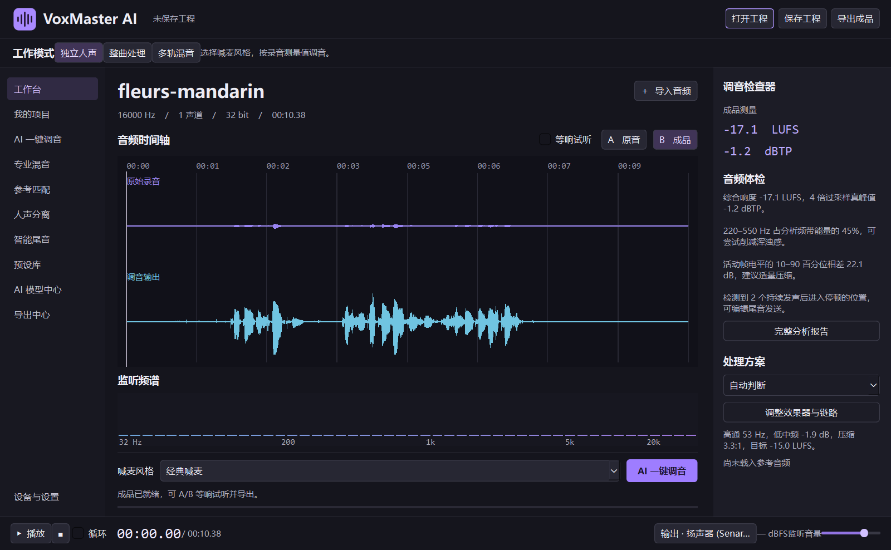
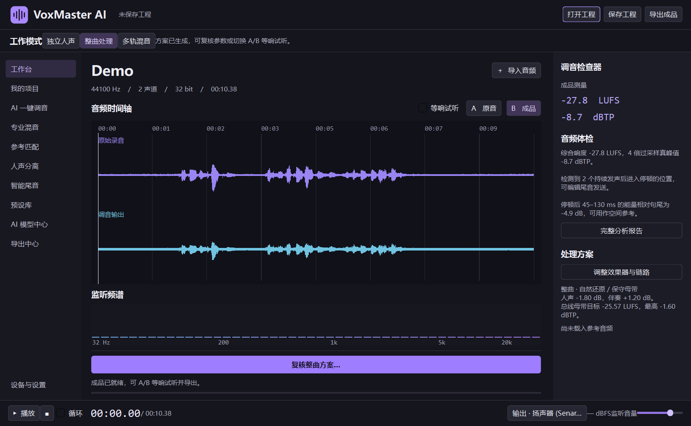
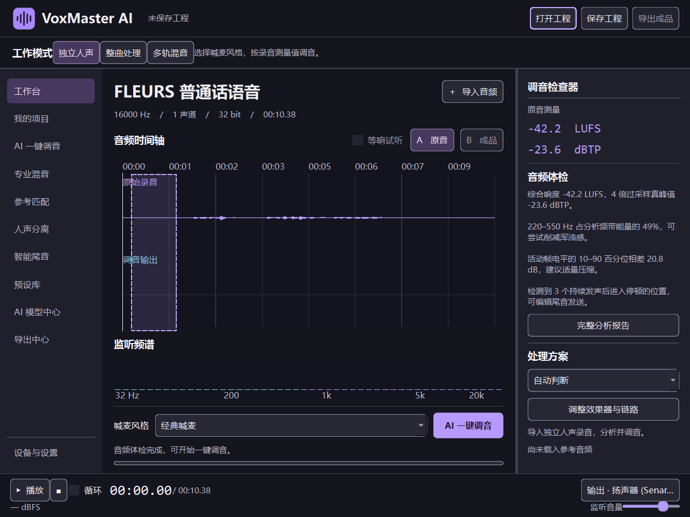
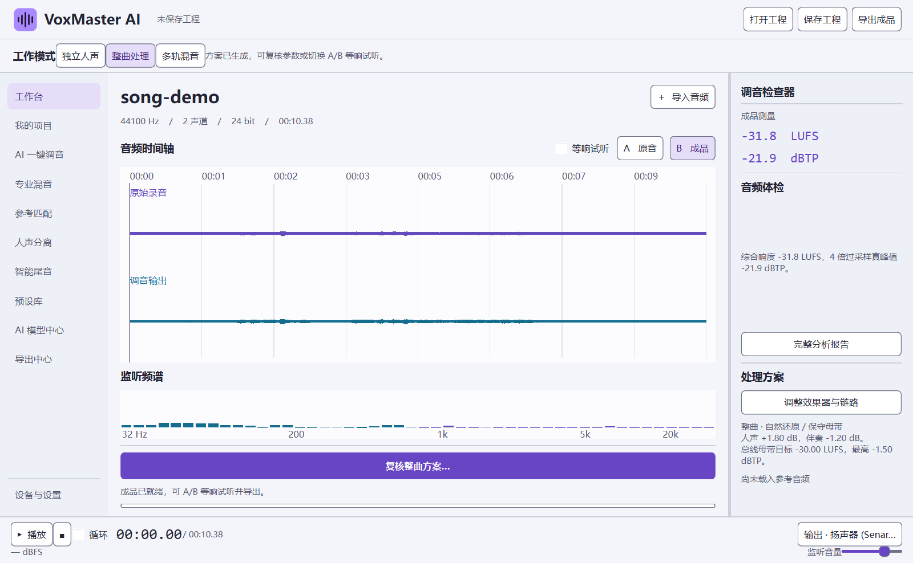

# VoxMaster AI 0.5.1（源码 / 发布候选）

**AI-Powered Vocal Production & Music Mixing Workstation** · 本地优先的人声制作与歌曲混音工作站

[](https://github.com/yuchen0x1/VoxMaster-AI/actions/workflows/ci.yml) · [官方下载](https://github.com/yuchen0x1/VoxMaster-AI/releases/latest) · [反馈](https://github.com/yuchen0x1/VoxMaster-AI/issues)

## 0.5.1 兼容修复候选

当前正式下载通道仍为 **0.5.0**；0.5.1 未获得当前版本人工听审批准前，不宣称已正式发布。

- 外部多轨素材增加 SHA-256 内容身份与提交前复核，同大小/同修改时间的替换会重新读取；渲染中被改动或删除的素材不会提交到当前会话，外部别名不遮蔽内置人声/伴奏。
- 成品和轨道导出提交后不再误报晚到取消；临时文件清理失败会明确警告，已有录音/成品仍禁止覆盖。整曲 CLI 在母带编码失败时仍返回已保存的分轨与恢复工程。
- 多轨恢复取消或失败后可在窗口内重新定位；损坏/过短候选可改选，完整恢复前不允许应用不完整混音。异常最近工程记录不再阻断恢复入口，附属记录写入失败与工程保存成功分开提示。
- 历史备份相对定位素材，支持随工程目录整体搬迁；模型迁移持锁后复核活动目录。官方及自定义清单检查支持取消与安全收尾，过期结果不覆盖当前状态。
- 安装/便携版只携带明确审核的离线手册与导航，不递归附带研发日志。源码归档排除未跟踪文档、私有目录及 Windows junction 别名，校验暂存树与工作树的一致性，并兼容 LF/CRLF。
- 叠加淡入/淡出使用有界包络乘积细分，避免端点直连造成错误静音；保留 v1 格式及撤销/重做。

不更换人声 DSP 默认链、分离模型、`.voxproj` v1 格式、默认音色或导出规格，不新增运行依赖；淡变修改仅纠正用户叠加编辑的包络乘积。[整合交付与未验边界](docs/DELIVERY-051.md) · [前期能力与验证](docs/EVOLUTION-051.md) · [精确提交开源研究](docs/RESEARCH-051.md) · [安全与隐私核验](docs/SECURITY-051.md)。正式发布仍须通过本版本人工听审与发行验收门禁，不以版本号或候选构建代替公开发布。

## 0.5.0 更新

0.5.0 是首个公开发布版本：包含 0.4.0 的完整歌曲工作流与本轮双主题界面改造。候选与发布状态、听审门禁见 [发布说明](docs/releases/release-notes.md)。

0.4.0 将处理路径显式分为 **独立人声、完整歌曲、专业多轨** 三种模式，共用本地音频分析、DSP 与现有多轨混音引擎。完整歌曲模式复用本地按需下载的 Spleeter 双轨模型，提供人声/伴奏独立处理、可编辑混音目标、峰值受限的最终母带及质量报告；分轨与处理在工程提交前完成，取消或失败保留原工程。保守方案不会默认对已含空间效果的人声再次降噪、修音、加混响或做音高修正。原 `v1` 工程继续读取，新增方案作为可选字段保存。**分离重建误差不能证明分离质量**；两首指定参考歌曲的主观听审仍待制作人完成。[项目审计](docs/AUDIT-040.md) · [DSP/模型审计](docs/AUDIT-AUDIO-040.md) · [竞品研究](docs/RESEARCH-040.md) · [38 项取舍](docs/UPGRADE-040.md) · [测试与素材报告](docs/TESTS-040.md)

Windows 本地喊麦与歌曲制作工作站。人声处理继续使用测量驱动 DSP；模式选择和音频角色需要用户确认，自动声学线索仅作参考。媒体与模型均不上传服务器。完整版本记录见 [CHANGELOG](CHANGELOG.md)。





截图来自 Windows 原生 Qt 运行；整曲界面使用 **CC BY 4.0 FLEURS 真人语音 + 合成伴奏** 演示，不是两首私有参考歌曲，也不作真人歌曲音质验收证据。[参数复核](docs/evidence-040/song-review.png) · [现有多轨工作室](docs/evidence-040/studio.png)。

现有喊麦人声链会按信号证据分别处理快速咬字、爆发音和拖腔。在「完整分析报告」中可以选一句看判断依据，比较均衡器前后的频谱、压缩器的实际衰减，再等响试听某个效果器。支持在音高曲线上框选、手动移调和编辑尾音，保存后可重新打开工程。[版本变更](CHANGELOG.md) · [专项验收](docs/UPGRADE-011.md)

## 双主题与界面验收

「设备与设置 → 外观」支持 **跟随系统 / 浅色 / 深色**，切换立即预览，取消恢复原主题，保存后下次启动继续使用。原生 Qt 控件、菜单与自绘波形/图表共用语义颜色；系统标题栏及 OS 原生文件选择器仍由系统管理。较小窗口可滚动访问全部操作，时间轴增加键盘定位与选区，原音频引擎、工程格式和导出规格不变。

完整界面清单、前后截图、双主题与有效 DPI 验收、独立二审和未验边界见 [UI/UX 专项报告](docs/UIUX-040.md)。上面的 0.4.0 旧截图早于新主题，不代表当前外观。





这两张截图来自本轮隔离快照的真实 Windows/Qt 渲染，不是界面设计稿；使用 CC BY 4.0 FLEURS 及合成素材，不是私人歌曲，也不代表主观音质听审通过。[更新窗口](docs/evidence-051/update-light.png) · [本轮验证边界](docs/EVOLUTION-051.md)。

## 安装和首次使用

标准构建输出的 Windows x64 安装版为 `dist/VoxMasterAI-Setup.exe`，按当前用户安装，支持从 Windows 应用列表卸载。便携版为 `dist/VoxMasterAI-Portable.zip`，请解压整个目录后启动 `VoxMasterAI.exe`。发布流水线在隔离注册表环境完成安装/卸载验收后才允许公开发布。两种发行物包含 Python、Qt、音频编解码器和本地推理运行库。软件设置、自动保存与默认模型放在当前用户的 LocalAppData 中。便携版也使用这个位置。

1. 启动后进入「设备与设置」查看自动生成的硬件报告，选择监听设备。
2. 将 WAV、MP3、FLAC、M4A、AAC、OGG 或 AIFF 拖入窗口。分析完成后，在时间轴下方选择喊麦风格。
3. 点击「AI 一键调音」。渲染完成后点击播放，用 A、B 切换原音和成品。「等响试听」便于排除响度变化带来的听觉偏好。
4. 点击「导出成品」，选择 WAV、FLAC、MP3 或 AAC，然后选择新的文件名。保存为 `.voxproj` 可在日后重新编辑。

## 功能

| 工作流程 | 可以操作的内容 |
|---|---|
| 音频分析 | 综合与三秒短时 LUFS、四倍过采样真峰值、RMS、峰均比、频带能量、频谱重心、动态跨度、满幅平顶候选、声道相关度、嗡声、基频与句尾位置。分段列出九种候选类型的判断、置信度、证据及限制 |
| 人声调音 | 18 种可编辑风格，降噪、参数 EQ、压缩、齿音抑制、饱和、音高修正、空间、立体声和母带。支持调整效果器顺序与旁通，保存个人预设和导入导出 |
| 参考匹配 | 比较开头、普通发声、高能量、拖腔、尾音和结束段。可等响试听同一风格加入参考建议前后的差异，或恢复匹配前参数 |
| 旋律与尾音 | 按音高曲线选区移调、调节响应速度、撤销与试听。可伸缩局部尾音，编辑延迟重复次数、空间发送，试听下一句的起音 |
| 工作模式 | 独立人声调音；完整歌曲本地双轨分离、人声/伴奏分开处理、混音与最终母带；已有分轨及多轨时间线编辑。混音目标与母带参数可调、可撤销 |
| 分离与混音 | 双轨分离、宽带侧链、冲突频带避让、人声居中、单声道折叠检查、轨道与总线效果链、分轨导出；立体声分类不确定时需要用户确认 |
| 完整歌曲质检 | 分别测量两轨与成品的 LUFS、真峰值、频带、动态、声道相关性及母带前后变化；重建误差只表示相加守恒，须另行试听判断分离质量 |
| 工程 | 本地工程引用、自动保存、保存前版本备份、最近工程、丢失文件重新定位、当前会话内撤销与重做 |
| 本地运行 | 默认离线调音，显卡推理失败可回退 CPU；官方更新校验 Ed25519 清单、下载大小与 SHA-256，再由用户启动安装器；本机记录会话健康标记，异常退出下次启动提示 |

## 平台与批处理

| 形式 | 状态 | 更新方式 |
|---|---|---|
| Windows 11 x64 桌面 | 主要交付；Windows 10 仍待实机验收 | 官方更新窗口或 Release；无 Authenticode、自动安装回滚 |
| Linux / macOS Intel / Apple Silicon 源码 | 原生 CI 试验支持；实体监听和安装包未验收 | 新建独立 Python 环境升级，可保留旧环境回退 |
| CLI | analyze / tune / song / styles；整曲处理在本机执行，使用已安装模型并拒绝覆盖素材 | 随产品版本更新 |
| 手机、Web、PWA、扩展、Docker/NAS | 暂不开发 | [逐平台评估与原因](docs/PLATFORMS.md) |

```powershell
python app.py --cli analyze tests/fixtures/fleurs-mandarin.wav --report analysis.json
python app.py --cli tune recording.wav second.wav --output-dir outputs --format flac
python app.py --cli song full-song.mp3 --output-dir outputs --target natural --master conservative --report outputs/song-report.json
python app.py --cli styles
# Windows 专用控制台启动器不带 --cli 前缀：
# VoxMasterAI-CLI.exe song full-song.mp3 --output-dir outputs --format flac
```

结果为 JSON；批量中某文件失败会继续其他文件并以非零码退出。`--report` 默认拒绝覆盖已有报告；只有明确希望替换普通 JSON 报告时才加 `--overwrite-report`。该选项不允许覆盖输入音频、计划成品、模型文件或恢复工程，也不允许覆盖成品；同名输入使用不同输出目录。Linux 需 PortAudio/EGL 和中文字体，macOS 需 PortAudio。用户数据分别使用 LocalAppData、XDG_DATA_HOME、Application Support；可用 VOXMASTER_DATA 指定隔离目录。[更新机制与恢复](docs/UPDATING.md)

## 开发和构建

使用 64 位 Python 3.11、Windows 10/11、Qt Widgets（PySide6）、NumPy、SciPy、PyAV、PortAudio 和 ONNX Runtime。发行物使用音频专用 FFmpeg 共享库。开发工作环境使用 PyAV 官方 wheel，构建脚本会替换其编解码库。完整的依赖版本见 requirements.txt。

```powershell
py -3.11 -m venv .venv
.\.venv\Scripts\python.exe -m pip install -r requirements.txt
.\.venv\Scripts\python.exe app.py
.\.venv\Scripts\python.exe -m pytest -q
```

模型推理回归需要预先下载权重，将 `VOX_MODEL_TEST_WEIGHTS` 设置为含两个 ONNX 文件的模型版本目录，再运行测试。构建 x64 安装包和便携包需要 MSYS2 UCRT64 GCC、bash、Inno Setup 6，以及第一次获取固定源码的网络连接。工程根目录下运行以下命令。如工具装在其他位置，脚本支持传入 Bash 和 InnoCompiler 路径。

```powershell
.\scripts\build.ps1
```

## 硬件与兼容边界

需要 Windows 10/11 x64（Inno 目标下限为 Windows 10 1809；**本轮只实测 Windows 11 Build 26300**）。不使用分离模型时，基础人声 DSP 可离线运行，不要求 GPU；分离支持 CPU，Windows 包可用 DirectML，驱动/推理失败按现有顺序回退 CPU。CUDA 不在本轮 Windows 安装包中，未声称新 CUDA 验收。模型约 75 MiB，由用户确认后按需获取，不随包附带。

本轮实测主机为 Ryzen 9 8945HX、系统报告 79.2 GiB RAM、RTX 5060 Laptop 8 GiB。本轮没有低内存机器或大于 30 分钟音频的资源测试，因此不提供“已验证的最低内存/显存”承诺。解码可使用磁盘映射，但完整渲染仍需要与音轨时长和数量相关的内存；长工程应预留本地缓存/成品磁盘空间。[本轮性能数据与缺测](docs/PERFORMANCE-040.md)。

## 模型与许可

模型管理器提供约 75 MiB 的 Spleeter 双模型，支持暂停、续传、校验与迁移。完成下载后可离线使用。权重发布渠道、校验值与适用范围见[模型说明](docs/MODELS.md)。本项目源代码按 [MIT LICENSE](LICENSE) 授权；Qt、编解码库、推理库、第三方模型权重及测试录音各自的许可仍分别适用，模型权重不因此自动变为 MIT。[第三方清单](docs/THIRD_PARTY.md) · [测试录音署名](tests/fixtures/README.md)。

## 使用边界和常见问题

- **为什么导出的响度低于设定值？** 过载保护会优先保留峰值余量。可以通过压缩、增益衰减曲线和等响试听决定是否继续逼近目标。
- **为何不能导入 NCM？** 当前解码器接受上列标准音频格式。可以使用可直接播放的 MP3、FLAC 或自己的录音。
- **96 kHz 导出能否保留整个高采样率源频带？** 内部总线为 44.1 kHz 双声道，编码时支持重采样。MP3 支持 44.1 和 48 kHz。
- **分离后为什么仍能听到伴奏？** 模型的有效带宽约为 11 kHz，密集和声与乐器重叠会产生渗漏。两轨重建精度衡量混音是否守恒，人声提取质量另有已知分轨测试。
- **可否在一句普通说话上自动修音？** 自动模式在旋律证据不足时保留语调，手动选择旋律类型可开启音准调整。拖腔与句尾依据信号特征判断，歌词含义、人物身份和重点词语未做语义识别。
- **安装包适用于哪些环境？** 本机实测 Windows 11 x64。发行包用 DirectML 或 CPU 分离。独立 CUDA 环境在 RTX 5060 Laptop 上验证过两个模型图的运算。Windows 10、跨实体屏和实体耳机拔插仍需补测。安装包未签名。[兼容性记录](docs/COMPATIBILITY-011.md)

## 真实音频与听审

两版各自对五首本地中文混音整曲执行一键调音。把《本地私有验收素材 P001》00:57–01:09 的两个成品截取、匹配到 −23 LUFS 并隐藏版本，听者选中 A，揭盲对应 0.1.1。两版试听相差 0.001 LU。此次得到一位听者对一个片段的偏好；设备、分项打分与选择原因均未提供。另有带作者记录的真人 Rap、长音、气声等测试材料。用户歌曲仅供本机验收。[音频报告](docs/AUDIO-011.md) · [听审记录与评分表](docs/LISTENING-011.md) · [测试素材与来源](tests/mc_corpus/README.md)

[使用手册](docs/MANUAL.md) · [多轨编辑手册](docs/MULTITRACK.md) · [技术架构](docs/ARCHITECTURE.md) · [工程基线与开源调研](docs/RESEARCH.md) · [音频验收记录](docs/ACCEPTANCE.md)

[阶段验收与剩余限制](docs/PROGRESS.md) · [构建、安装与卸载验证](docs/PACKAGING.md) · [本轮项目审计](docs/AUDIT-2026-11-19.md)

[自动化测试](docs/TESTS-011.md) · [压力测试与资源占用](docs/PERFORMANCE-011.md) · [音高和尾音操作](docs/PITCH-TAIL-011.md) · [竞品与技术参考快照](docs/RESEARCH-2026-11-19.md)
