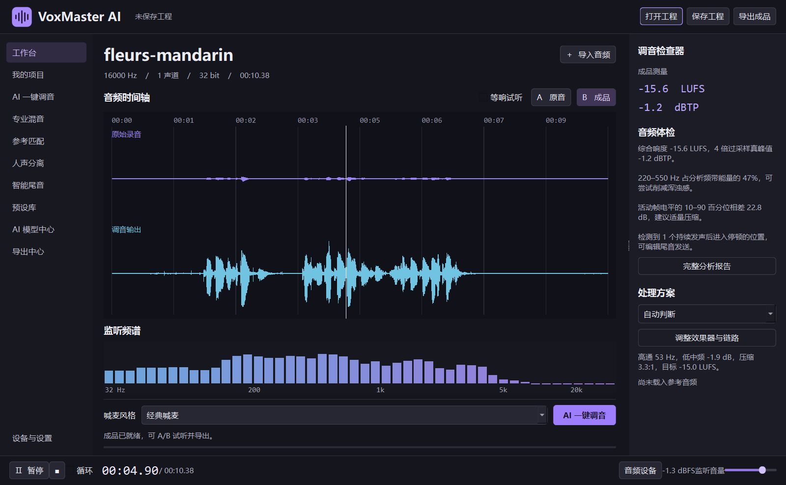

# VoxMaster AI 0.2.0

[](https://github.com/yuchen0x1/VoxMaster-AI/actions/workflows/ci.yml) · [官方下载](https://github.com/yuchen0x1/VoxMaster-AI/releases/latest) · [反馈](https://github.com/yuchen0x1/VoxMaster-AI/issues)

## 最新更新

0.2.0 新增官方签名更新窗口、离线命令行分析与批量调音，并为 Linux/macOS 源码环境适配系统目录、字体和 CPU 推理依赖。Windows 继续提供安装和便携形式；其他桌面平台进入原生 CI 试验支持，尚无正式安装包。[完整版本记录](docs/releases/release-notes.md) · [实际交付与未验证项](docs/DELIVERY-020.md)

Windows 本地喊麦调音工作站。导入录音后可查看波形、响度、动态与音高，选择风格执行一键调音，再做等响 A/B 试听。基础调音使用测量值驱动的 DSP。人声分离使用可选的 Spleeter 神经网络，音频与模型推理都在本机。



0.1.1 的一键调音会分别处理快速咬字、爆发音和拖腔。在「完整分析报告」中可以选一句看判断依据，比较均衡器前后的频谱、压缩器的实际衰减，再等响试听某个效果器。支持在音高曲线上框选、手动移调和编辑尾音，保存后可重新打开工程。[版本变更](CHANGELOG.md) · [专项验收](docs/UPGRADE-011.md)

## 安装和首次使用

Windows x64 安装版为 `dist/VoxMasterAI-Setup.exe`，按当前用户安装，支持从 Windows 应用列表卸载。便携版为 `dist/VoxMasterAI-Portable.zip`，请解压整个目录后启动 `VoxMasterAI.exe`。两种发行物包含 Python、Qt、音频编解码器和本地推理运行库。软件设置、自动保存与默认模型放在当前用户的 LocalAppData 中。便携版也使用这个位置。

1. 启动后进入「设备与设置」查看自动生成的硬件报告，选择监听设备。
2. 将 WAV、MP3、FLAC、M4A、AAC、OGG 或 AIFF 拖入窗口。分析完成后，在时间轴下方选择喊麦风格。
3. 点击「AI 一键调音」。渲染完成后点击播放，用 A、B 切换原音和成品。「等响试听」便于排除响度变化带来的听觉偏好。
4. 点击「导出成品」，选择 WAV、FLAC、MP3 或 AAC，然后选择新的文件名。保存为 `.voxproj` 可在日后重新编辑。

## 功能

| 工作流程 | 可以操作的内容 |
|---|---|
| 音频分析 | 综合与三秒短时 LUFS、四倍过采样真峰值、RMS、峰均比、频带能量、频谱重心、动态跨度、满幅平顶候选、声道相关度、嗡声、基频与句尾位置。分段列出九种候选类型的判断、置信度、证据及限制 |
| 人声调音 | 18 种可编辑风格，降噪、参数 EQ、压缩、齿音抑制、饱和、音高修正、空间、立体声和母带。支持调整效果器顺序与旁通，保存个人预设和导入导出 |
| 参考匹配 | 比较开头、普通发声、高能量、拖腔、尾音和结束段。可等响试听同一风格加入参考建议前后的差异，或恢复匹配前参数 |
| 旋律与尾音 | 按音高曲线选区移调、调节响应速度、撤销与试听。可伸缩局部尾音，编辑延迟重复次数、空间发送，试听下一句的起音 |
| 分离与混音 | 双轨分离、人声与伴奏自动平衡、宽带侧链、冲突频带避让、人声居中、单声道折叠检查、轨道与总线效果链、分轨导出 |
| 工程 | 本地工程引用、自动保存、保存前版本备份、最近工程、丢失文件重新定位、当前会话内撤销与重做 |
| 本地运行 | 默认离线调音，显卡推理失败可回退 CPU；官方更新校验 Ed25519 清单、下载大小与 SHA-256，再由用户启动安装器 |

## 平台与批处理

| 形式 | 状态 | 更新方式 |
|---|---|---|
| Windows 11 x64 桌面 | 主要交付；Windows 10 仍待实机验收 | 官方更新窗口或 Release；无 Authenticode、自动安装回滚 |
| Linux / macOS Intel / Apple Silicon 源码 | 原生 CI 试验支持；实体监听和安装包未验收 | 新建独立 Python 环境升级，可保留旧环境回退 |
| CLI | 与桌面共享同一音频引擎，多文件串行且保护已有文件 | 随产品版本更新 |
| 手机、Web、PWA、扩展、Docker/NAS | 暂不开发 | [逐平台评估与原因](docs/PLATFORMS.md) |

```powershell
python app.py --cli analyze tests/fixtures/fleurs-mandarin.wav
python app.py --cli tune recording.wav second.wav --output-dir outputs --format flac
# Windows 包中亦可用控制台启动器 VoxMasterAI-CLI.exe --cli ...
```

结果为 JSON；批量中某文件失败会继续其他文件并以非零码退出。禁止覆盖成品；同名输入使用不同输出目录。Linux 需 PortAudio/EGL 和中文字体，macOS 需 PortAudio。用户数据分别使用 LocalAppData、XDG_DATA_HOME、Application Support；可用 VOXMASTER_DATA 指定隔离目录。[更新机制与恢复](docs/UPDATING.md)

## 开发和构建

使用 64 位 Python 3.11、Windows 10/11、Qt Widgets（PySide6）、NumPy、SciPy、PyAV、PortAudio 和 ONNX Runtime。发行物使用音频专用 FFmpeg 共享库。开发工作环境使用 PyAV 官方 wheel，构建脚本会替换其编解码库。完整的依赖版本见 requirements.txt。

```powershell
py -3.11 -m venv .venv
.\.venv\Scripts\python.exe -m pip install -r requirements.txt
.\.venv\Scripts\python.exe app.py
.\.venv\Scripts\python.exe -m pytest -q
```

模型推理回归需要预先下载权重，将 `VOX_MODEL_TEST_WEIGHTS` 设置为含两个 ONNX 文件的模型版本目录，再运行测试。构建 x64 安装包和便携包需要 MSYS2 UCRT64 GCC、bash、Inno Setup 6，以及第一次获取固定源码的网络连接。工程根目录下运行以下命令。如工具装在其他位置，脚本支持传入 Bash 和 InnoCompiler 路径。

```powershell
.\scripts\build.ps1
```

## 模型与许可

模型管理器提供约 75 MiB 的 Spleeter 双模型，支持暂停、续传、校验与迁移。完成下载后可离线使用。权重发布渠道、校验值与适用范围见[模型说明](docs/MODELS.md)。代码及产品标识的授权由作者决定，工程当前没有指定整仓对外开源许可证。Qt、编解码库、推理库及测试录音的许可分别保留。[第三方清单](docs/THIRD_PARTY.md) · [测试录音署名](tests/fixtures/README.md)

## 使用边界和常见问题

- **为什么导出的响度低于设定值？** 过载保护会优先保留峰值余量。可以通过压缩、增益衰减曲线和等响试听决定是否继续逼近目标。
- **为何不能导入 NCM？** 当前解码器接受上列标准音频格式。可以使用可直接播放的 MP3、FLAC 或自己的录音。
- **96 kHz 导出能否保留整个高采样率源频带？** 内部总线为 44.1 kHz 双声道，编码时支持重采样。MP3 支持 44.1 和 48 kHz。
- **分离后为什么仍能听到伴奏？** 模型的有效带宽约为 11 kHz，密集和声与乐器重叠会产生渗漏。两轨重建精度衡量混音是否守恒，人声提取质量另有已知分轨测试。
- **可否在一句普通说话上自动修音？** 自动模式在旋律证据不足时保留语调，手动选择旋律类型可开启音准调整。拖腔与句尾依据信号特征判断，歌词含义、人物身份和重点词语未做语义识别。
- **安装包适用于哪些环境？** 本机实测 Windows 11 x64。发行包用 DirectML 或 CPU 分离。独立 CUDA 环境在 RTX 5060 Laptop 上验证过两个模型图的运算。Windows 10、跨实体屏和实体耳机拔插仍需补测。安装包未签名。[兼容性记录](docs/COMPATIBILITY-011.md)

## 真实音频与听审

两版各自对五首本地中文混音整曲执行一键调音。把《王斩 - 习武弃文》00:57–01:09 的两个成品截取、匹配到 −23 LUFS 并隐藏版本，听者选中 A，揭盲对应 0.1.1。两版试听相差 0.001 LU。此次得到一位听者对一个片段的偏好；设备、分项打分与选择原因均未提供。另有带作者记录的真人 Rap、长音、气声等测试材料。用户歌曲仅供本机验收。[音频报告](docs/AUDIO-011.md) · [听审记录与评分表](docs/LISTENING-011.md) · [测试素材与来源](tests/mc_corpus/README.md)

[使用手册](docs/MANUAL.md) · [多轨编辑手册](docs/MULTITRACK.md) · [技术架构](docs/ARCHITECTURE.md) · [工程基线与开源调研](docs/RESEARCH.md) · [音频验收记录](docs/ACCEPTANCE.md)

[阶段验收与剩余限制](docs/PROGRESS.md) · [构建、安装与卸载验证](docs/PACKAGING.md)

[自动化测试](docs/TESTS-011.md) · [压力测试与资源占用](docs/PERFORMANCE-011.md) · [音高和尾音操作](docs/PITCH-TAIL-011.md)
