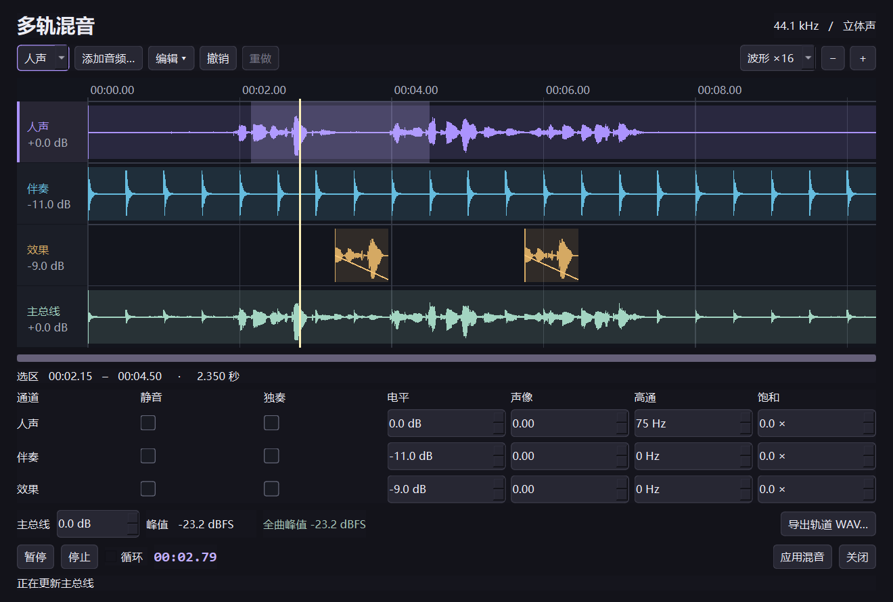

# 多轨混音

打开一段音频后，在左侧选择「专业混音」。人声、伴奏和效果轨共用 44.1 kHz 时间轴。应用过一键调音时，人声轨使用已渲染的人声。使用人声分离后，分轨文件会出现在对应轨道上。

图中人声来自项目测试集 FLEURS 中文朗读。伴奏为合成底鼓，效果轨放置了两个带淡出的短片段。截图使用 16 倍波形显示，垂直倍率只影响显示。

## 安排片段

1. 单击轨道标签选择轨道，单击波形定位光标。用「添加音频」将文件放在当前光标处，重叠部分被新片段取代。
2. 横向拖动波形划出选区，双击片段可选中整段。在「编辑」中选择「设置选区」，也可以用秒数输入起止位置。
3. 复制或剪切选区后，切换目标轨道，在光标处粘贴。删除和剪切会留下静音空隙，其他轨道的位置保持对齐。
4. 「移动选区至」按输入的秒数平移片段。「分割」在光标处拆开片段，「合并相邻片段」用于重新接上时间连续、对应同一素材连续采样的片段。
5. 「淡入」「淡出」作用于当前选区。在片段上定位后选择「包络点」，输入该处电平，可在同一片段上连续添加节点。

工具栏的加减按钮缩放时间范围，底部滚动条可浏览放大后的工程。波形展示源素材振幅，金色曲线表示片段音量自动化。可撤销最近 80 步编辑并重做。关闭窗口会放弃本次编辑，「应用混音」将编辑状态交回当前工程。

## 电平与试听

每条轨道都可单独调节电平、声像、高通频率和饱和度。声像位于 -1 到 +1，0 为居中。向一侧平移时，中置信号按等功率曲线移动，侧边宽度逐步收窄。高通为 0 Hz、饱和度为 0 时相应处理旁通。静音键优先于独奏，可同时独奏多条轨道。主总线电平作用于混合后的立体声。第四条波形为实际渲染的主总线，峰值保护触发时会显示保护前峰值与整体衰减量。

拖出选区后按播放可试听局部，勾选「循环」会重复所选范围。未选区时播放完整混音。工作台沿用主窗口的输出设备和监听音量。调整电平、声像、滤波、饱和度、静音或独奏时，工作台在后台更新主总线。试听继续使用已有缓冲，渲染结束后在原播放位置交叉淡化到新混音，生效时间取决于工程长度。片段编辑会停止试听。试听的峰值读数为主总线采样峰值。最终成品响度和真峰值通过应用混音后的分析报告查看。

点击「导出轨道 WAV」可将所选轨道单独输出为 24-bit 立体声 WAV。分轨从总线时间零点写入，保留前导静音，导出长度与工程相同。轨道导出包含自身声像、效果和音量，忽略用于监听的静音、独奏和主总线电平。请选择尚不存在的文件名。

## 0.1.1 自动平衡与响度

在独立的人声与伴奏轨上编辑好片段，再打开「自动平衡与响度」。工作台测量当前编排的每轨及主总线综合响度、左右声道相关度和折叠为单声道的能量差。折叠损失超过 6 dB 时显示抵消提醒。无有效信号时会显示响度低于门限。

勾选播放栏的「单声道监听」可以在同一输出设备试听左右声道平均后的结果，播放期间会交叉淡化切换。主总线波形、工程设置和导出保留立体声。

平衡建议使用两轨同时活动的短窗。界面列出参与分析的窗数、中位 RMS 电平，以及两轨共享能量最高的频带。伴奏推子建议计入即将施加的侧链压缩和频带衰减。活动窗不足时仍可手动设置。

- **人声触发伴奏避让**。人声超过阈值时，侧链可衰减整条伴奏或选定频带。整体和选频衰减均设上限，攻击时间为 14 毫秒，释放时间为 190 毫秒。伴奏独奏与分轨导出保留侧链，静音人声会停用触发信号。
- **人声居中**。可将声像移回正中或逐渐收窄左右差异。遇到左右声道反相的录音时，建议保留原宽度并检查单声道试听。
- **响度匹配**。在下拉框切换为「匹配目标响度」，选择任意有可测响度的通道或主总线。界面显示目标 LUFS 和对应的推子变化，单次提升最多 9 dB。动态处理与峰值保护会影响最终结果，可以重新测量。

「应用」将本次变更作为一个撤销步骤。「启用人声侧链与居中路由」单独控制动态避让与宽度，伴奏推子及声像独立保存。

## 轨道与总线效果器链

「效果器链」支持分别设置人声、伴奏、空间效果轨与主总线的存在感 EQ、压缩与立体声宽度。选择效果并用上、下移按钮调整串联顺序。取消勾选会旁通该效果并保留其参数。所有通道修改可作为一步应用或取消。分轨导出使用轨道自身的效果链，主总线效果只在混合输出路径生效。旧版工程首次载入时沿用原有混音，新增处理全部处于中性参数或关闭状态。

## 0.1.1 实录回归

2026-11-18 在 Windows 11 上截取本机授权参考录音（private-reference-01）45–57 秒，用固定权重的 Spleeter CPU 模型重新分离，共 529,200 帧。两轨相加还原输入的最大误差为 5.96×10⁻⁸。下表为该段素材的实测结果。

| 测量 | 平衡前 | 平衡后 |
| --- | ---: | ---: |
| 人声综合响度 | −12.47 LUFS | −12.48 LUFS |
| 伴奏综合响度 | −9.04 LUFS | −14.04 LUFS |
| 主总线综合响度 | −8.27 LUFS | −9.63 LUFS |
| 主总线采样峰值 | −0.18 dBFS | −0.71 dBFS |
| 主总线左右相关度 | 0.881 | 0.896 |

144 个重叠活动窗的共享能量集中在 180–450 Hz。建议伴奏推子为 −3.38 dB，宽带侧链上限为 1.64 dB，285 Hz 邻域衰减上限为 0.45 dB。重新加载保存的编排后，输出与首次混音逐样本一致。主观听感留给等响 A/B 听审记录，测试录音与分轨保留在本机。

## 工程恢复

应用混音后，在主窗口保存工程。工程保留素材路径、片段时间、源采样范围、包络、轨道参数与主总线设置。移动素材到其他位置后，打开工程时可重新定位。混音缓冲为内存中的双声道浮点音频，超长工程的处理能力受可用内存限制。

| 快捷键 | 动作 |
| --- | --- |
| 空格 | 播放、暂停或继续 |
| R | 输入选区起止秒数 |
| S | 在光标处分割 |
| Ctrl+C / Ctrl+X / Ctrl+V | 复制、剪切和粘贴 |
| Delete | 删除选区 |
| Ctrl+Z / Ctrl+Y | 撤销和重做 |
