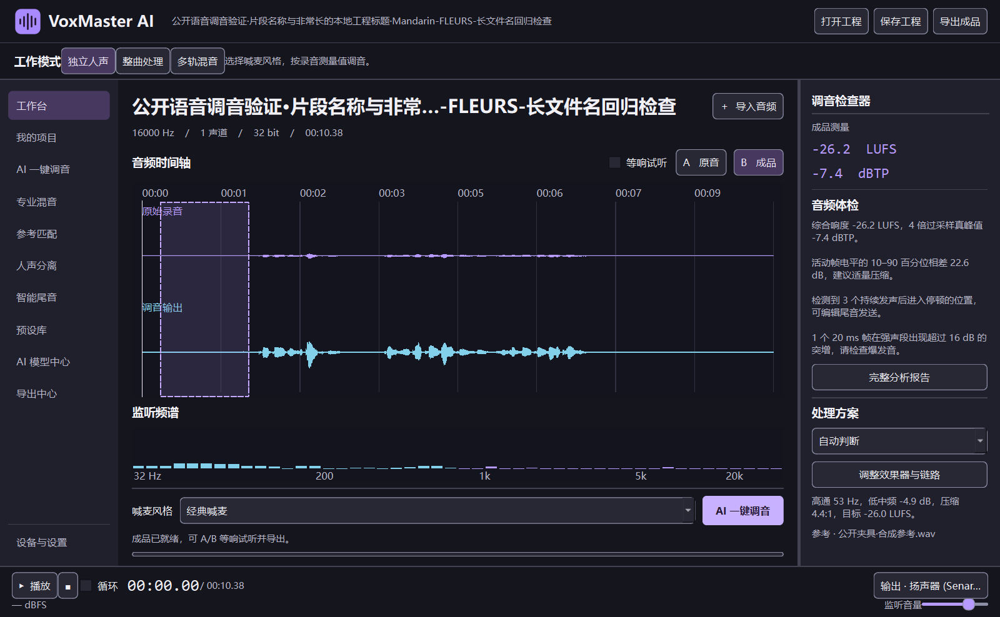
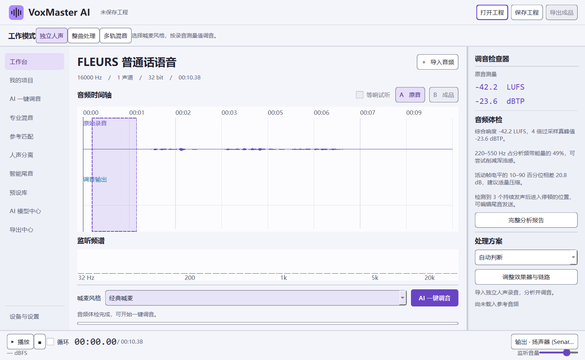
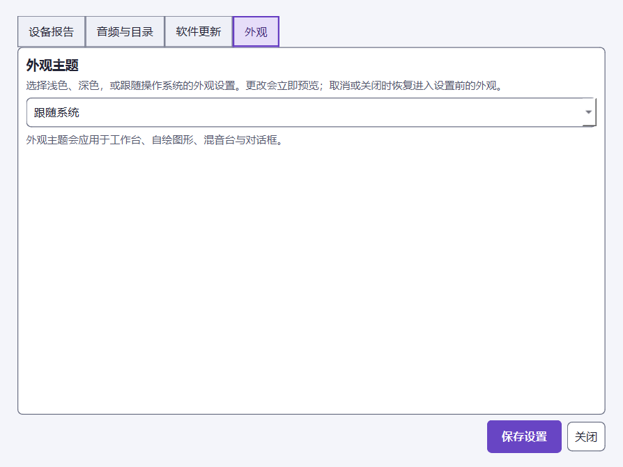
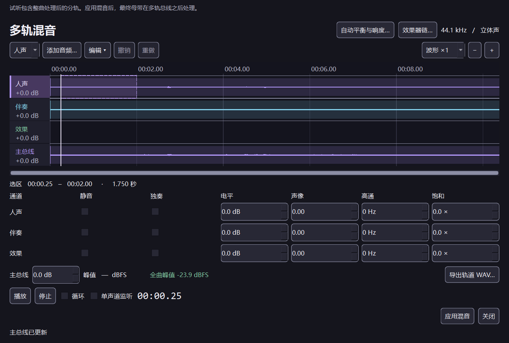
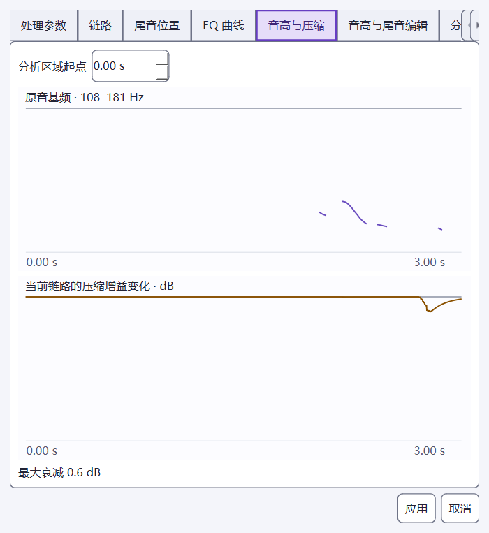
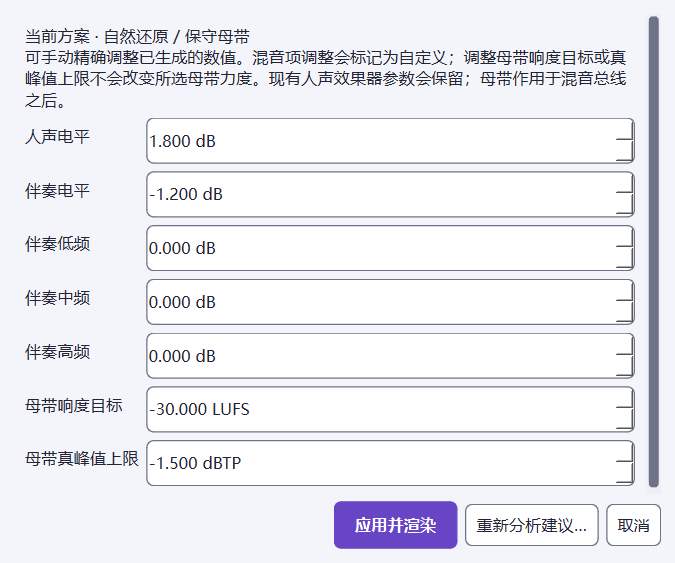
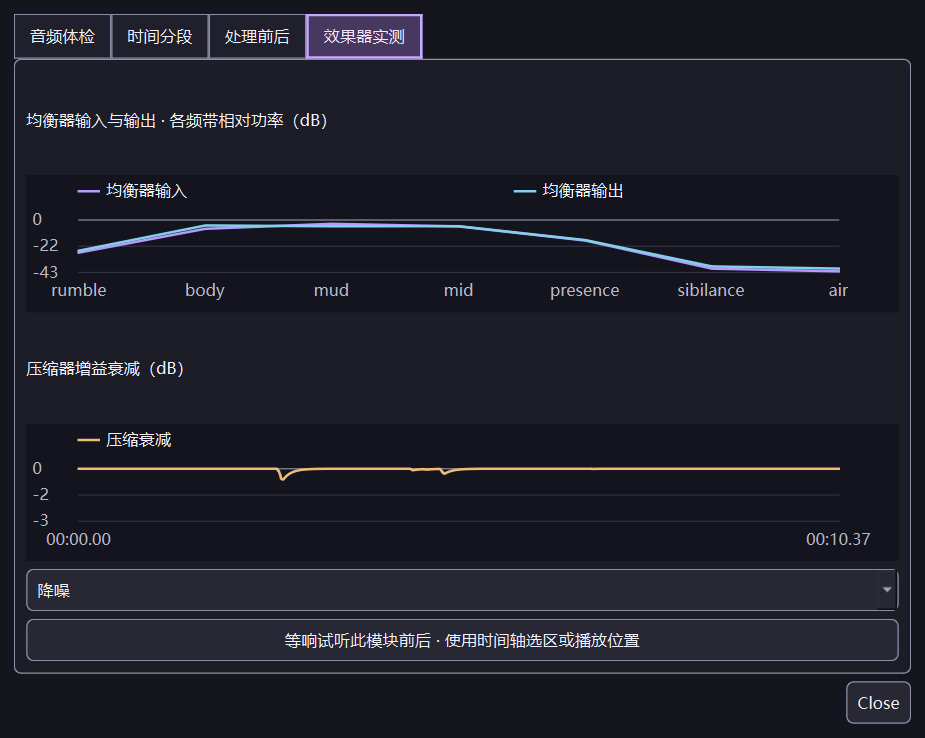
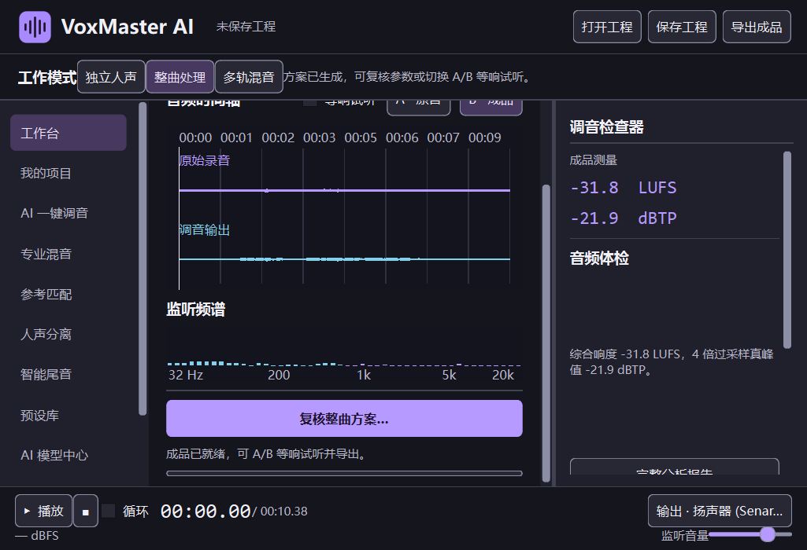

# VoxMaster AI 双主题与 UI/UX 专项验收

日期：2026-11-20（执行跨本地午夜，最终日志时间以 JSON/JUnit 为准）。分支：`feat/uiux-dual-theme`；基线：`1e6447f`。本报告对应未提交的后续 UI 改动，不表示已发布 0.4.0 或已更新旧候选包。

## 1.【体检总览】

### 平台、范围与计数口径

实际为 **Python 3.11 / PySide6 6.12 / Qt Widgets + QPainter 原生桌面应用**，不是 Web、QML 或 Electron。本轮未更换技术栈、音频依赖、工程格式、处理 API 或模型，也未新增运行依赖。Windows 11 x64 Build 26300 原生验证；系统字符串中的 Windows-10 不等于 Windows 10 实机。

- **15 个产品自有窗口**：MainWindow；ParameterDialog、ExportDialog、ReportDialog、PreviewDialog、SettingsDialog、UpdateDialog、ModelDialog、SongDialog、StudioDialog、RackDialog、BalanceDialog；另有我的项目、参考匹配、预设库 3 个内联 QDialog。
- **2 个自有菜单**：主时间轴与多轨时间轴菜单。
- **28 个 Qt 标准模态调用点**：QFileDialog 14、QInputDialog 6、QMessageBox 8。与前两项组成 45 项入口清单，**不是 45 种窗口**。截图脚本按具体状态展开成 7 个输入和 9 个消息场景，不与调用点数量混算。
- **29 个逻辑嵌套区**：主工作区 6、多轨区 6、参数页签 7、报告页签 4、设置页签 4、平衡窗口条件页 2；条件页/状态不是独立窗口。
- **27 类显式标准 QWidget**；7 类 QPainter 画布、9 个显示位置：主波形、监听频谱、多轨波形、EQ、2 个 DSP Trace、音高画布、2 个报告 TracePlot。不重复计 Qt 自动产生的内部子控件。
- 所有参数/报告/设置页签，以及整曲方案的新建、复核和错误分支、音频格式、空态/有素材/成品态均纳入检查。未将测试专用 `report_text` 算成产品入口。

### 问题数、评分与诊断

按下节**根因组**计数，不把 110 处颜色表达式当作 110 个 Bug：22 个工程问题组，另有 4 个明确的实机验收缺口。最终关闭状态见问题表和测试记录；缺测不算通过。

采用可复核的专项检查计分：表中每格 1 分，共 **23 个计分点**，按达成数换算百分制（`达成/23×100`，四舍五入），而不是假定的用户满意度或“专业审美分”：

| 检查项 | 基线 | 修改后证据 |
|---|---|---|
| 手动深色；浅色；跟随系统 | 1/3 | 三模式入口、归一化与持久化测试 |
| 同实例动态切换；取消预览恢复 | 0/2 | 设置窗口及已打开画布/窗口测试 |
| 全自绘语义配色；关键文字/状态对比 | 0/2 | 7 类画布与颜色/光栅复核 |
| 小窗可滚动；长标题非零宽且省略 | 0/2 | 820×560、560×420、420×320 与真实标题几何 |
| 主时间轴键盘；多轨键盘定位 | 0/2 | 信号接线、连续 Shift、放大后 EndPATH_REDACTED
| EQ 数值替代；音高选区数值替代 | 2/2 | 旧功能保留，继续运行数值编辑/撤销测试 |
| Space 原生控件优先；设置失败完整回滚 | 0/2 | 真实按键及 PermissionError 注入 |
| 原生勾选/单选可见；页签窄窗可达；弹窗内容自适应 | 0/3 | 原生指示器光栅、页签末页可达、sizeHint 断言 |
| 音频功能回归 | 1/1 | 全量测试和两首本机真实整曲回解码 |
| 真实 OS 主题开关；实体混合 DPI；屏幕阅读器完整任务；跨 OS GUI 实机 | 0/4 | 本轮仍未全部验收，不计分 |

基线达成 **4/23 ≈ 17/100**；本轮目标检查达成 **19/23 ≈ 83/100**（剩余 4 分即上表未完成的实机验证）。此分数仅表达这张专项清单：不意味着基线音频质量差，也不意味着新 UI 获得 WCAG 全面认证。未完成的 4 项实机验证明确扣分。

**一句话诊断：根因不是“换几个背景色”，而是固定暗色 QSS、自绘颜色、原生控件状态和小窗尺寸约束没有统一管理；本轮以共享 Token/Palette、真实几何与交互回归闭环修复。**

## 2.【问题清单】

严重程度：🔴高（核心可用性/主题切换失败），🟡中（操作、阅读或适配障碍），🟢低（局部体验）。状态只在有实测后关闭。

| # | 位置 | 已确认的问题/边界 | 程度 | 维度 | 状态 |
|---|---|---|---|---|---|
| 01 | app / 设置 | 仅固定暗色，没有三模式入口、系统跟随和外观持久化 | 🔴 | 主题架构 | 已修、定向与原生切换验证 |
| 02 | 全部 7 类画布 | 颜色在 paintEvent 内硬编码，无法随主题更新 | 🔴 | 图表/主题 | 已修、同实例像素测试 |
| 03 | Studio | 滚动条、勾选框、时钟、状态的局部暗色样式阻断统一主题 | 🔴 | 主题残留 | 已移除，走全局主题/语义状态 |
| 04 | Qt 控件/浮层 | 原有样式没有完整 Palette 和表头、弹出列表、Tooltip/菜单两套映射 | 🟡 | 原生资源 | 已补，全部入口截图 |
| 05 | 音高画布 | 100/200/400 刻度约 1.58:1，误用网格颜色绘文字 | 🟡 | 文字对比 | 改 muted 独立画笔，计算及截图验证 |
| 06 | 主操作/导航/输入 | 专用规则覆盖焦点边框，状态映射不完整 | 🟡 | 焦点/状态 | 已补 default/hover/pressed/focus/disabled |
| 07 | 三类时间选区 | 低透明度填充不足以作为唯一边界 | 🟡 | 非颜色信息 | 增虚线轮廓；保留区间数值 |
| 08 | 主时间轴 | 无画布键盘定位/选区；首次实现与原 seek(a) 接线冲突 | 🟡 | 键盘 | 加独立选择端点，真实 MainWindow 接线测试 |
| 09 | 多轨时间轴 | 新增键盘 End 在放大后把光标移出视口，滚动条未同步 | 🟡 | 键盘/视口 | 已修 offset/view_changed/末端像素，独立复现后复核 |
| 10 | 参数链路 | 拖动排序缺少直接键盘可达的排序替代 | 🟡 | 键盘 | 加上移/下移，原 item/旁通勾选/序列化不变 |
| 11 | 主窗口 | 较小窗口导航、工作区和单行传输区挤占，原下限不支持目标 820×560 | 🟡 | 布局 | 导航/中心滚动，传输两行，检查器不可折叠 |
| 12 | 参数/音高/报告/混音/整曲弹窗 | 长表单和横向按钮行在较小尺寸存在裁切/溢出 | 🟡 | 弹窗适配 | 分组表单、双列按钮和滚动，原功能保留 |
| 13 | 图表与表单 | 符号按钮/画布/部分数值字段缺显式名称或 buddy | 🟡 | 可访问性 | 补语义名称/说明/字段关联；不等同屏幕阅读器认证 |
| 14 | 工程/素材标题 | 长标题缺可控省略；新 ElidedLabel 曾被 stretch 分成 0 宽 | 🟡 | 文本布局 | 分配 stretch，完整 text/Tooltip/辅助描述保留，三尺寸宽度测试 |
| 15 | 检查器 | 小窗真实多段 issues/plan 被分配 29–160px，高度需求 176px；仅 Minimum policy 不足 | 🟡 | 动态换行 | WrappedLabel 随文本/宽度/字体/样式维护真实最小高度，原生补拍验收 |
| 16 | Main / Studio | 全局 Space 抢走按钮和复选框的原生 Space 操作（基线也存在） | 🟡 | 键盘 | focus guard 仅控制 Space，控件优先，画布继续播放 |
| 17 | 设置保存 | 写入失败只回滚部分设置，实际输出设备/缓存和文字可能与旧设置不一致 | 🟡 | 事务/反馈 | 捕获真实运行态、失败完整恢复并刷新设备显示 |
| 18 | 多轨选中区域 | 后置透明填充洗掉波形，实测降至约 2.06/2.33:1；浅色选中伴奏/FX 小字约 4.46/4.43:1 | 🟡 | 图形/文字对比 | 填充前置、轮廓后置；选中名称使用 on_selected，复核 ≥3/4.5 |
| 19 | 主题管理器 / 模型中心 | ModelDialog.update 是既有 QPushButton，遮蔽 QWidget.update；全量切主题出现 TypeError | 🔴 | 跨窗口兼容 | 显式 QWidget.update(widget)，不重命名旧按钮 API，真实窗口回归 |
| 20 | 勾选/单选指示器 | 仅定制 indicator 尺寸导致 Qt 原生指示器消失 | 🔴 | 状态可见性 | 已修，恢复原生形状，两主题状态光栅复核 |
| 21 | 参数页签条 | 较窄窗口 7 个页签需 570px 只给 538px，被裁切出现空槽 | 🟡 | 弹窗适配 | 已修：页签不省略、滚动按钮可见可用，末页签可达 |
| 22 | 整曲方案弹窗 | 固定 540×560 高度在短方案下方留出大片空白 | 🟡 | 布局 | 已修：按 sizeHint 与屏幕上限自适应，有高度断言 |
| 23 | 系统主题 | Qt 信号路径通过；未擅自改变用户 OS 主题开关作实测 | 🟡 | 实机验证 | 未验，不冒充真实 OS 切换 |
| 24 | 混合 DPI 多显示器 | 四个有效 DPR 进程矩阵不等于跨实体显示器拖动 | 🟡 | 实机验证 | 未验，保留后续验收 |
| 25 | 屏幕阅读器 | 有语义名称、buddy、Tab/Space 测试，未完成 NVDA 全工作流 | 🟡 | 辅助技术 | 未验，不宣称 WCAG 全面合规 |
| 26 | 其他 OS / 原生系统弹窗 | 本轮没有 Win10、macOS/Linux GUI 实机及所有 OS 文件选择器版本 | 🟢 | 平台验证 | 未验，Qt fallback 仅算 fallback |

## 3.【主题残留专项报告】

### 扫描与分类

基线 `app.py + vox` 共 44 个 Python 文件；颜色集中在 6 个模块。共 110 处颜色表达式（105 个 HEX、3 个 RGBA、1 个 fromRgbF、1 个 white）；分类为品牌 2、数据信号/状态 21、应主题化界面颜色 87。分类是审计用途，不是 87 个独立 Bug。

修改后颜色集中到 `vox/theme.py`：35 个语义 Token × 两主题，共 70 个 HEX 映射。主题模块外仍有 **10 个 HEX**，逐项有依据：

- `visual.app_icon()` 中 2 个品牌画稿颜色，刻意固定，不是界面背景或正文。
- `dsp_panel.BANDS` 4 个旧公开三元组颜色字段，仅为兼容旧调用；运行绘制使用独立 Token 映射。
- `studio_timeline.COLORS` 4 个旧公开颜色字段，仅为兼容；运行绘制走 `TRACK_COLOR_TOKENS`。

应用正文/控件/自绘的运行颜色不再依赖这些兼容 HEX。未发现 SVG 文件、SVG 加载、QRC、Designer UI 或独立打包字体，故不存在“已替换全部 SVG”之类虚构成果。原生箭头/勾选等应由 Qt 控件绘制，不用假静态图替代交互。

### 浅暗残留与第三方边界

- 生产启动在 MainWindow 创建前安装主题；`visual.STYLES` 保留 `stylesheet("dark")` 作为旧启动器 API，不再作为生产动态状态。
- 所有图表在绘制时取当前 Token，订阅主题变化；不依赖重建工程或重启窗口刷新。
- Studio 的内联颜色已移除；状态由动态 property + repolish 管理，避免从深色切浅色后遗留状态色。
- 选择区、轨道、双系列曲线均保留名称/图例或数值边界，不能只靠紫/蓝区分。多轨选区先画底再画波形，防止 alpha 把波形洗淡。
- Qt 自有菜单、下拉 view、表头、Tooltip、QMessageBox、QInputDialog 和非原生 QFileDialog 使用统一 Palette/QSS。主题不承诺覆盖由系统管理的标题栏和 OS 原生文件选择器。
- 没有 Web/CSS 框架、嵌入浏览器或第三方图表组件，不引入 Web 工具模拟桌面验收。

## 4.【改造方案与实际修改】

| Before → After | 实际文件/方法 | 验证 |
|---|---|---|
| app 固定 STYLES → 启动读取 theme | `app.py`、`theme.install_theme` | 隔离配置原生启动、保存后恢复 |
| 分散颜色 → COLORS/Palette/QSS | `vox/theme.py` | 对比度断言、native 全窗截图 |
| 设置无外观 → 第四页外观/即时预览/取消恢复 | `settings_dialog._appearance/_restore_theme_preview/value` | unknown key 保留、reject/X 关闭恢复 |
| 多窗口 update() → Qt 基类 update | `ThemeManager.set_mode` | 真实 ModelDialog 不联网开窗切换 |
| 固定图表 → paintEvent 运行时取色 | `visual`、`studio_timeline`、`dsp_panel`、`pitch_tail_editor`、`review` | 同一实例 light/dark/light 光栅 |
| 单行拥挤 → 原组件滚动/分行 | `interface.build_ui`、`studio`、`studio_mix_dialogs`、`song_dialog`、`dialogs` | 小窗布局、Tab 自动滚入视口 |
| 拖动独占 → 数值/键盘替代 | 主/多轨 Timeline、链路上移下移、原 EQ/音高字段 | 接线级测试与编辑/撤销 |
| 长标题裁切 → middle elide + 完整元数据 | `visual.ElidedLabel` | text 不删，实际布局宽度非零 |
| 换行标签可压缩 → 自适应最小高度 | `visual.WrappedLabel` | 真实多段报告、原生补拍 |
| Space 全局抢占 → 控件优先 | `visual.TransportShortcutGuard` | checkbox/button/canvas 实际按键 |
| 页签窄窗裁切 → 完整标题+滚动按钮 | `dialogs` ElideNone、`theme` QTabBar 滚动按钮样式 | 末页签可达、每页签完整宽度断言 |
| 整曲弹窗固定高度 → 内容自适应 | `song_dialog` sizeHint + 屏幕上限 | 高度≈sizeHint、不小于最小尺寸 |
| 设置部分回滚 → 实际 device/cache/theme 同步回滚 | `interface.settings_view`、`audioio.cache_directory` | PermissionError 注入、设备文字与 cache 一致 |

代表性实现，均为真实产品代码：

```python
# 启动时就选择主题，不先闪现固定暗色。
install_theme(app, preferences().get("theme", "system"))

# 保留旧同名按钮字段，不用重命名公开 API 来规避冲突。
for widget in self.app.topLevelWidgets():
    QWidget.update(widget)

# 不能靠隐藏长报告“修复”小窗：让滚动区域承载真实高度。
height = max(0, self.heightForWidth(max(1, self.width())))
if self.minimumHeight() != height:
    self.setMinimumHeight(height)
```

**保留项**：18 风格、人声与整曲处理、真实本地模型、所有导入/导出、原项目/恢复/撤销、原菜单和多轨快捷键均保留；未用 Mock 替代核心音频验收，未删失败测试，未改版本号或发布门禁。

### 前后截图

以下公开截图取自最终源码的原生捕获轮（`final-verify` 与 `final-native125`），全部为 FLEURS 普通话夹具（CC BY 4.0）加本地合成信号，署名见 `tests/fixtures/README.md`；完整基线与全部轮次保存在 Git 忽略的 `.audit/uiux-20261120/`，不进入源码归档。私人歌曲、文件名、指纹与分轨不出现在任何公开图中。

















## 5.【设计 Token 建议】

以下不是另起一套设计稿，而是**当前代码实际使用**的映射：

| Token | 浅色 | 深色 | 用途 |
|---|---|---|---|
| window | #F4F5FA | #15151D | 主窗口 |
| surface | #FFFFFF | #1D1D28 | 页面/列表 |
| panel | #EEF0F7 | #20202D | 侧栏/检查器 |
| input | #FFFFFF | #282835 | 输入/普通按钮 |
| elevated | #FFFFFF | #2C2C3B | 菜单/浮层 |
| text | #222334 | #F1F0F7 | 正文 |
| muted | #55586D | #B9B8CB | 次要文字/图刻度 |
| disabled | #707486 | #9D9BAE | 禁用文字 |
| disabled_bg | #EBEDF3 | #242430 | 禁用背景 |
| border | #6E7387 | #8C8EA5 | 可辨控件边界 |
| divider | #CCD0DD | #414151 | 装饰分隔线 |
| hover | #E8E4F7 | #383348 | 悬停 |
| pressed | #DACEF4 | #443759 | 按下 |
| accent | #6845C4 | #B69AFF | 主操作 |
| accent_hover | #5937B1 | #C8B2FF | 主操作悬停 |
| on_accent | #FFFFFF | #20142F | 主操作/选中条文字 |
| selected | #E6DDF9 | #47385F | 选中背景 |
| on_selected | #3E2575 | #F0E5FF | 选中背景文字 |
| focus | #663DC2 | #C5A8FF | 焦点/选区轮廓 |
| success | #23734C | #82CCA3 | 成功文字 |
| warning | #8A5100 | #F0BC73 | 警告文字 |
| error | #B52D39 | #FF9CA7 | 错误文字 |
| info | #216896 | #8ECFF0 | 信息文字 |
| canvas | #FCFCFF | #14141E | 自绘底色 |
| grid | #E0E3EC | #303040 | 辅助网格（不作文字） |
| grid_strong | #737B90 | #85879D | 关键网格/基准线 |
| wave_a | #6749BE | #B69AFF | 原音/系列 A |
| wave_b | #146D8E | #83D0EB | 成品/系列 B |
| cursor | #2C1A52 | #F4EBFF | 时间游标 |
| track_vocal | #6749BE | #B69AFF | 人声轨信号 |
| track_music | #146D8E | #83D0EB | 伴奏轨信号 |
| track_fx | #23734C | #82CCA3 | 效果轨信号 |
| band_low | #9C5600 | #F0BC73 | 低频/衰减曲线 |
| band_mid | #6845C4 | #B69AFF | 中频/曲线 |
| band_high | #146D8E | #83D0EB | 高频/曲线 |

- 字体继续使用平台 `ui_font()` 回退：正文 10pt、说明 9pt、区标题 11pt、主标题 18pt；时间码保留等宽用途。画布不再自行固定某个中文字体或 9px 字号。
- 间距基础：4/8/12/16/24/32px；圆角：控件 6px、卡片 8px。既有布局按需要渐进采用，不声称每个历史 margin 都已机械归零重写。
- 动效时长 0ms，切换即时，没有新增强制动画；不宣称检测了 OS reduced-motion 设定。
- `divider/grid` 是辅助装饰，不被误当作正文颜色。禁用控件依法可有对比豁免，但仍保留明确禁用态；不以禁用豁免掩盖可操作控件。

## 6.【改造优先级路线图】

| 优先级 | 本轮完成 | 剩余/阻塞 |
|---|---|---|
| P0 | 三模式、启动/预览/持久化、全部自绘与原生 Palette、跨窗口切换异常、可见原生指示器 | 无未决项 |
| P1 | 小窗滚动、动态长文本、键盘定位/排序、Space 优先、焦点/状态/对比、设置失败回滚 | 实体多屏和屏幕阅读器完整任务需要相应实机/辅助技术验收 |
| P2 | 手册/变更日志/截图与自动化 harness、语义名称/图例、旧常量 API 兼容 | Win10 与其他 OS GUI 实机；OS 标题栏/文件选择器按系统行为验收 |

未引入账号、云端音频上传、云推理或模型自动下载。未将较小窗口简单提高最小尺寸来掩盖布局问题；Studio 仍保留原 560×420 下限。

## 7.【测试验收结果】

### 静态、回归与真实音频

| 项目 | 实际结果/边界 |
|---|---|
| 改造前全量 | 437 项（套件计数）：436 通过、1 跳过、0 失败/错误，201.209s；跳过为本机符号链接权限 |
| 首次改造后全量 | 9 failure + 2 teardown error + 1 skip，222.346s；不是通过。主要为模型中心 `update` 按钮遮蔽，另有 2 项新 harness 初稿断言错误；原失败日志保留 |
| 中间修复全量 | 修复遮蔽与最后样式后 465 通过、1 跳过、0 失败，222–368s 区间两轮 |
| **最终源码全量** | **473 项（套件计数）：472 通过、1 跳过、0 失败/错误，214.343s；独立 testcase 节点 469：468 通过、1 跳过。节点与套件计数差异来自 pytest 收集/teardown 记账，两口径均为 0 失败** |
| 新增定向 | 主题/工作台/Studio/效果器/截图契约 5 个新文件，全部用例已并入最终全量；另有稳态布局、指示器、页签、弹窗专项用例通过 |
| 静态检查 | Ruff F（保留项目既有 F841 例外）、compileall、git diff --check 在最终源码通过；Git 的 LF→CRLF 提醒不是 lint 失败 |
| 冻结构建 | 对最终源码重新快照（247 文件逐字节一致，含全部最后修复与新文件）后真实冻结：PyInstaller 6.22.3 双 EXE，冻结 GUI `--verify-package` 通过（Qt windows 平台、PortAudio V19.7.0、FFmpeg 8.1.2、DSP changed_rms 0.0509、wav/mp3/flac/aac 编解码验收、依赖版本与 requirements 一致）；冻结 CLI `--version/styles/analyze/tune` 通过；`VoxMasterAI-Source.zip` 247/247 条目与快照及工作树逐字节一致（sourceequal 通过，私有媒体/权重 0 泄漏）。隔离候选 Portable 127M / Setup 115M / Source 3.7M 含 SHA256SUMS，仅存于 git 忽略目录；未安装、未发布，root dist、旧候选与生产安装未触碰。frozenDML 分离验收未跑（避免与全量测试争用模型锁），GUI 交互式人工验收未做 |
| 真实私人整曲 | 两首均真实 DirectML，natural/conservative，24-bit FLAC 44.1kHz stereo；无下载/上传/播放 |

匿名真实回解码结果（帧为每声道帧数）：

| 音频 | 时长（秒）/帧数：输入→输出 | LUFS：输入→输出 | 真峰值 dBTP：输入→输出 |
|---|---|---|---|
| A | 104.881633 / 4,625,280 → 相同 | −3.968711 → −15.000000 | +3.482526 → −6.617961 |
| B | 117.069660 / 5,162,772 → 相同 | −4.649895 → −15.000000 | +3.340660 → −6.912539 |

实际 provider 两首均 `DmlExecutionProvider`，无 CPU 回退；输出削波采样 0、无 NaN/Inf、warnings 0，输入处理前后哈希一致。原输入本身存在超过 0dBTP 的估计真峰值，不描述为“输入无超峰”。另有 16 个真实解码缓冲的 offscreen GUI 状态组合验证标题/波形/导出使能；offscreen 字体目录警告不作原生字体验收证据。**未人工试听、未做等响盲听，本轮不认定音质获得主观批准。** 私有 paths、hash、日志和音频仅留本地忽略目录。

### 双主题、尺寸、状态与截图

- 基线：原生 Windows、89 张截图、最终捕获轮 errors/warnings 0；只有真实旧 dark，没有伪造 before-light。
- 修改后普通窗/小窗初轮各 90 张，新增外观页与后续状态使最终每轮为 91 张。
- 已完成 14 轮四 DPR/两主题/普通/小窗/最大化矩阵，每轮捕获 91 图、捕获 errors/Qt warnings 为 0；其中小窗旧批次发现真实裁切并保留，不算视觉通过。
- 指示器、动态文本、页签与弹窗修复后，最终确认轮 `final-verify-{dark,light}-{1280,820}` 各 91 张：0 错误、0 Qt 警告、0 裁切，实测 DPR 1.25；音高页 7 页签完整标题、滚动按钮带箭头且末页可达，整曲弹窗高度贴合内容，检查器相邻控件无重叠。
- 有效 **DPR 1.00/1.25/1.50/2.00** 从 pixmap 实测，本机 OS 为 125%，对应 QT_SCALE_FACTOR 0.8/1/1.2/1.6。DPR2 请求 1280×790 时，实际高度被桌面限制到 788；最大化为 2048×1209 DIP。
- 普通 1280×790，主窗最小 820×560；Studio 560×420，参数/报告 420×320 的交互和滚动定向验证。不是手机响应式验收。
- 明确覆盖 focus/hover/pressed/disabled、真实进度回调、设置校验错误、模型/更新本地状态、素材缺失、工程不兼容、Studio 错误；不靠真实下载或破坏文件制造状态。
- 两菜单用真实 QMenu.exec 抓取关闭；文件对话框强制 Qt fallback 验证 14 个入口，不把它说成 OS-native picker 通过。
- 原生真实操作已验证设置外观选择、同实例主窗/设置切换和隔离 settings.json 持久化，应用正常退出。没有修改用户生产设置或 OS 主题。

### 对比度与可访问性实测

| 配对 | 浅色 | 深色 |
|---|---:|---:|
| text / surface | 15.46:1 | 14.74:1 |
| muted / window | 6.42:1 | 9.32:1 |
| on_selected / selected | 9.31:1 | 8.68:1 |
| on_accent / accent | 6.49:1 | 7.53:1 |
| focus / window | 6.40:1 | 9.01:1 |
| border / window、input、hover、pressed、selected 最低值 | 3.16:1 | 3.27:1 |
| canvas 上关键文字/波形/频带/游标 Token 最低值 | 5.48:1 | 7.88:1 |

多轨含 alpha 片段/选区的**实际光栅**另验：填充前置后浅色 Vocal/Instrumental 波形约 4.06/3.70:1，深色约 3.96/5.04:1，超过适用非文本 3:1；选中轨名称改用 on_selected，不再使用略低于 4.5 的系列色。Tab 用真正焦点控件发键验证，可自动滚入主窗/Studio 视口；既有 EQ/音高数值替代、排序按钮和 Space 原生操作均测试。

这些是关键项测试，不是覆盖每个字符、每款系统字体、所有 assistive technology 的 WCAG 2.2 AA 认证。

### 独立二审

二审未参与实现，以只读源码、真实 Qt 控件、按键和光栅独立复现。过程中先后发现并推动修复：多轨放大后键盘定位丢失视口、选区透明填充洗淡波形、选中轨名对比不足、Space 抢占原生控件、设置保存部分回滚、勾选/单选指示器不可见；主审全量补发现模型中心按钮遮蔽 `update` 方法，截图复核补发现零宽工程标题、动态报告压缩、页签溢出与整曲弹窗固定高度。上述全部修复均经二审光栅级或交互级复核确认，包括极端字号下的弹窗行为；最终结论为**二审通过，范围内无未决 P0–P2 问题**（另有"可用宽 <580px 时弹窗宽下限不参考屏幕宽度"的 P3 理论备注，产品目标设备最小窗 820 宽，不构成实际缺陷）。网络中断时恢复同一二审上下文，不将中断当作"审查通过"。

## 8.【最终结论】

本轮已实际修改工程，不止输出建议。主题架构、所有自有表面/画布接入、布局与键盘/设置事务、原生勾选指示器、页签滚动与整曲弹窗自适应修复均已落地：最终源码全量回归 0 失败（473 项、1 跳过），`final-verify` 四轮原生补拍 0 错误/0 警告/0 裁切，独立二审通过且范围内无未决 P0–P2 问题。按最终源码重新快照的隔离候选包已完成并通过冻结自检、CLI 验收与源码逐字节比对（见第 7 节）；全部凭证、哈希与日志留在 git 忽略目录。

**本报告交付时不能标为正式发布。** 原有人工音质听审、Windows 10 实机与 Authenticode 等门禁不因 UI 截图或 LUFS 通过而自动解除；候选包未安装。报告交付后项目进入 v0.5.0 候选发布流程（人工听审批准后才正式公开），当前状态见[发布说明](releases/release-notes.md)。剩余实机缺测按问题清单保留，不把未测试能力写成已完成。
