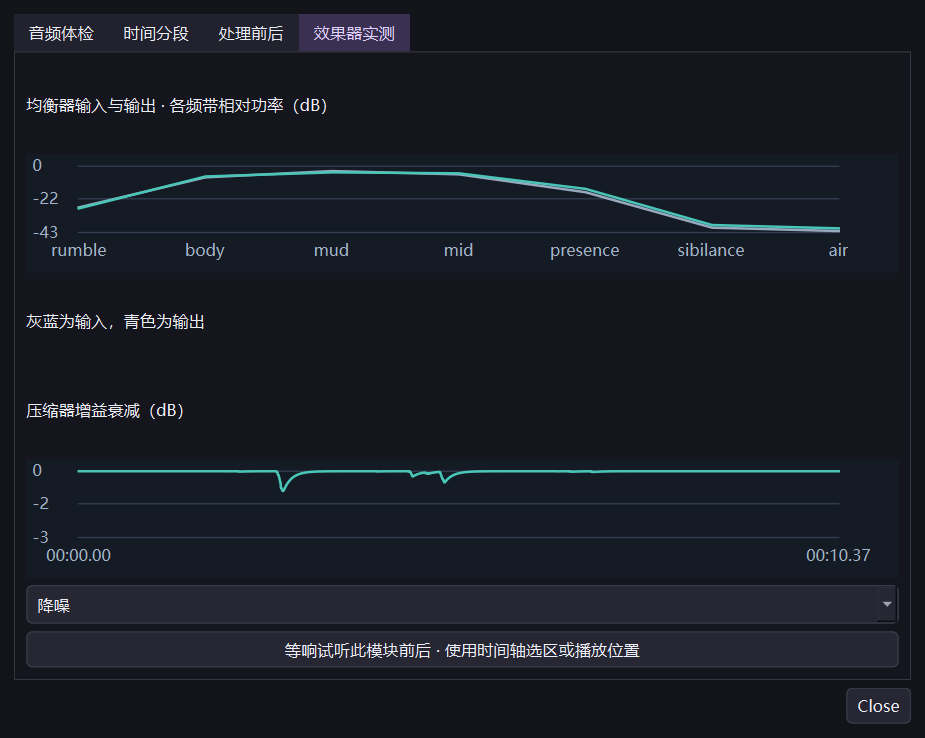

# 0.1.1 专项升级与验收清单

基线为 2026-11-18 的 Windows 11 本机工程，当前目录未初始化 Git。修改前在含模型权重的原始环境执行 pytest，70 项通过，耗时 17.51 秒。历史基线见 PROGRESS.md、ACCEPTANCE.md、RESEARCH.md、MODELS.md 和 PACKAGING.md。

| 专项 | 0.1.0 缺口 | 0.1.1 核查方法 |
|---|---|---|
| 真实音质 | 单句普通话派生样本和完整商业混音无法覆盖独立 MC 干声 | 五首整曲及另行查证许可的真人录音；每段保留参数、等响盲听文件及独立听审表 |
| 识别与调音 | 整轨归类、静态音色与压缩 | 连续分段、每段证据和限制、平滑控制、实测增益衰减、短时响度复测 |
| 参考匹配 | 全曲统计掩盖段落分布 | 按开头、普通段、高能量、拖腔、句尾、结束段分别对照；检验建议和实际渲染 |
| 音高与尾音 | 清晰单声部适用，尾音伸缩、下一句避让和曲线区域编辑缺口 | 实测有声区、移调与伸缩、局部旁通、下一句边界与撤销 |
| 混音 | 轨道独立调整，缺少随人声变化的避让 | 独立分轨的电平与频谱冲突测试，检查冷启动、监听和导出 |
| 硬件与稳定性 | Win10、独立 CUDA、物理热拔插、多屏和长时负载验证不足 | 分开记录实际系统、provider、显示环境、连续运行日志和未取得的硬件证据 |
| 交付 | 原版 0.1.0 | 保留旧版基线、回归、打包、隔离升级安装和便携版验证 |

## 0.1.1 验收结果

| 专项 | 结果与范围 |
|---|---|
| 中文喊麦与真人素材 | 23 份输入在两个版本各完成整段渲染。包含用户的五首中文混音、带标注的真人演唱、无伴奏 Rap 和两个实录受控重混。28 组三版本等响试听的最大组内差为 0.003 LU。中文原始干声、同一歌手标注的真假嗓转换、带距离记录的中文独唱仍是缺口。[逐条件证据表](AUDIO-011.md) |
| 人耳盲听 | 用户在《习武弃文》57–69 秒选择 A，揭盲为 0.1.1。最终音频代码在该区间逐样本复现了发给听者的版本。仅有一人一次偏好，分项评分、设备和原因留空。[听审表](LISTENING-011.md) |
| 分段识别、EQ、动态与降噪 | 每段给出时间、类型候选、置信度、证据及限制。平滑的控制曲线驱动滤波、压缩和干湿混合，GUI 可修改并等响试听。效果器报告只列实际改变采样的环节。九类启发式候选缺少独立带标签的准确率评估。[自动化测试](TESTS-011.md) |
| 参考、音高与尾音 | 已验证相同角色在不同编排下的匹配方向、保守调整与等响试听，工程提供匹配前参数还原。真人普通话局部上移两半音实测 2.027 半音，选区外样本一致。示例尾音延长 1.5 倍后，下一句首 150 ms 与原始段一致。真假嗓、共振峰自然度与长音抽吸感仍需逐句听审。[操作与测量](PITCH-TAIL-011.md) |
| 混音 | 在《起伏压声》真实分离轨中，重叠活动窗驱动伴奏推子、宽带侧链及 285 Hz 邻域避让。人声从 −12.47 到 −12.48 LUFS，伴奏从 −9.04 到 −14.04 LUFS。工程冷启动后逐样本复现。[实测与控制](MULTITRACK.md) |
| Windows 与设备 | Windows 11 x64、单机四档 Qt 缩放、三个真实输出端点、DirectML 与独立 CUDA 算子级检查通过。Win10、两台实体显示器和受控的实体拔出再接入仍待验收。[环境与故障](COMPATIBILITY-011.md) |
| 稳定性与工程 | 大型 WAV 解码、设备/模型故障、低磁盘及非正常退出分别记录验证方式。长时间运行保留原始时间戳、失败事件和重试日志。[性能报告](PERFORMANCE-011.md) |
| 本地交付 | 原有 70 项和全量 105 项回归通过。构建生成 Windows x64 安装版、便携包和源码包，0.1.0 历史文件保存在 dist/archive/0.1.0。[打包与安装范围](PACKAGING.md) |

